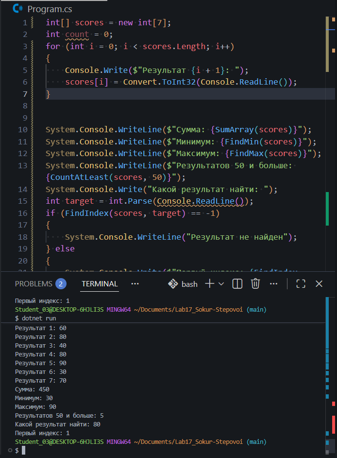

# Практическая работа №17

Авторы: Сокур Захар и Степовой Макар  
Группа: ИСП-252

## Тема

Алгоритмы обработки массивов.

## Что реализовано

- сумма элементов;
- подсчёт элементов по условию;
- минимум и максимум;
- линейный поиск;
- поиск первого индекса.

## Короткие ответы

1. Почему максимум нельзя всегда начинать с `0`?

Ответ: максимум нельзя всегда начинать с нуля потому что максимальным значением может быть отрицательное число

2. Что означает `-1` после поиска индекса?

Ответ: -1 после поиска индекса означает что цель не найдена

3. Чем сумма отличается от подсчёта элементов?

Ответ: в сумме мы складываем все элементы, а в подсчете считаем их количество

## Результат

